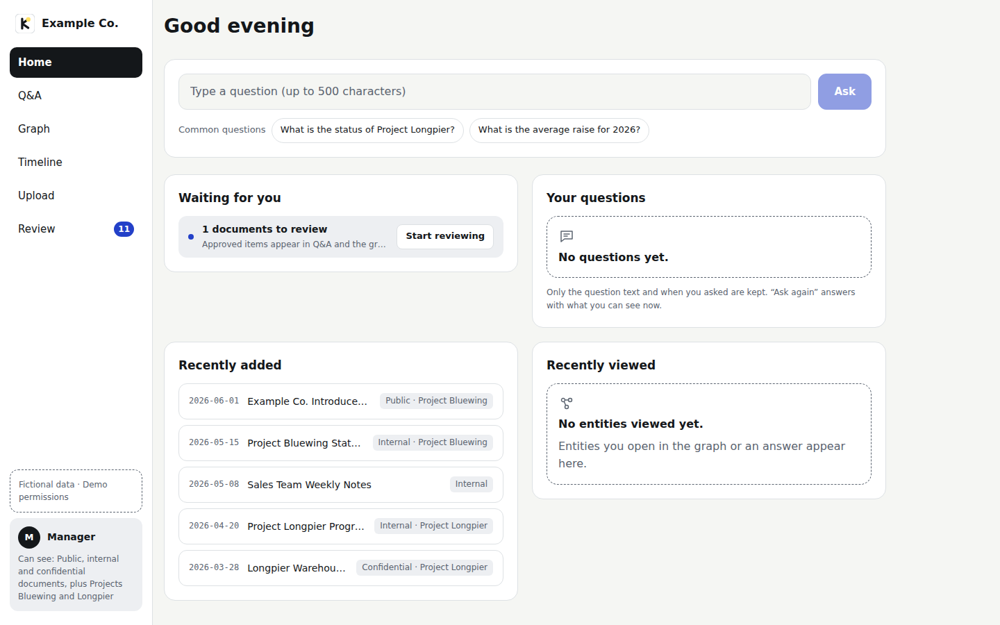

# knowledge-crew

knowledge-crew 是帶領 AI 員工的工作平台：交辦、驗收，信任隨驗收長出來。

- **建立在 knowledge-kit 之上**：本 repo 以 [knowledge-kit](https://github.com/BenTsai0212/knowledge-kit) 為上游，連同 git 歷史匯入，保留它的全部功能與 CI，之後持續同步（[ADR 0002](docs/crew/adr/0002-knowledge-kit-upstream.md)）。
- **與 CrewAI 框架無關**：名稱中的 crew 指「帶領一群 AI 員工」，本 repo 不使用、也不衍生自 CrewAI。
- **線上 demo**：只展示 AI 員工（虛構資料，不呼叫模型、不需要邀請碼）；網址在部署後補上，部署方式見 [docs/deploy.md](docs/deploy.md#只展示-ai-員工的線上-demo)「只展示 AI 員工的線上 demo」。
- 專案章程與決策紀錄：[docs/crew/rfcs/](docs/crew/rfcs/)、[docs/crew/adr/](docs/crew/adr/README.md)。knowledge-kit 的 [docs/rfcs/](docs/rfcs/)、[docs/adr/](docs/adr/README.md) 同樣有效，除非 knowledge-crew 的 ADR 另有決定。

以下是從 knowledge-kit 繼承的功能。knowledge-kit 是用虛構資料、快速為一個組織建立「第二大腦」知識平台 demo 的範本：換一個組織只改設定（`client/` 或 `clients/<名稱>/`），不改程式。demo 是展示用的原型，不是正式系統。

## Features

截圖使用虛構的參考情境（`client/`），身分為主管，由腳本產生（[docs/testing.md](docs/testing.md#readme-的截圖)「README 的截圖」）。

- **首頁**：問候、依角色的常見問題、問過的問題；主管看到「等你處理」，員工看到上傳與回報的動態。清單與數字只計算目前角色看得到的內容（[docs/design.md](docs/design.md#首頁)）。
- **問答**：回答附上依據的段落，點引用在右側開啟原文；「回答中提到的」列出實體、小型關係圖與「接著問」。看得到的文件中沒有答案時拒答並提供下一步（[docs/qa.md](docs/qa.md)）。
- **關係圖**：從文件抽取的實體與關係；搜尋或點選實體、逐步展開、依類型篩選、「找路徑」找兩個實體間的最短路徑（[docs/graph.md](docs/graph.md)）。
- **時間軸**：看得到的文件依日期、按年份分組，可依實體篩選（[docs/graph.md](docs/graph.md#時間軸readtimeline)）。
- **上傳與我的上傳**：上傳檔案或貼上文字，文件切成段落，可見層級預設為角色能選的最嚴格層級；實體與關係在背景抽取，審查通過才加入（[docs/upload.md](docs/upload.md)、[docs/design.md](docs/design.md#我的上傳)）。
- **審查**：可審查的角色核准或退回抽取結果；系統先整理（同名單一候選建議合併、已存在的關係不重建），與既有段落說法不同的上傳標為衝突資訊（[docs/extraction.md](docs/extraction.md)、[docs/conflicts.md](docs/conflicts.md)）。
- **評估頁與品質報告**：網址加 `?tools=evals`、且角色可審查時才出現；執行題庫並評分引用、要點、拒答與洩漏，可下載可列印的 HTML 報告（[docs/evals.md](docs/evals.md)）。
- **展示模式**：網址加 `?mode=presentation`，只保留問答與關係圖、放大文字，頂列切換身分（[docs/qa.md](docs/qa.md#展示模式)）。
- **手機與平板**：手機用底部分頁列與底部面板，平板用左側圖示列與右側滑入面板（[docs/design.md](docs/design.md#手機與平板)）。
- **每一頁**：依可見層級與專案權限顯示文件，由 PGlite 的 row-level security 執行（[docs/data-model.md](docs/data-model.md)）；多語介面與檢索，可選用瀏覽器內的語意向量（`multilingual-e5-small`）做跨語言檢索（[docs/client-config.md](docs/client-config.md)、[docs/retrieval.md](docs/retrieval.md#語意向量multilingual-e5-small)）；主題色與深色模式。



## 快速開始

需要 Node 22 以上。

```bash
npm install
npm run dev
```

以 Vite 開發伺服器啟動參考情境（`client/`）。瀏覽關係圖、時間軸與文件不需要金鑰。要提問時，以自己的 Anthropic API key 在本機執行 Worker：

```bash
cp .dev.vars.example .dev.vars
npm run build
npx wrangler dev
```

執行 `npx wrangler dev` 前，在 `.dev.vars` 填入 `ANTHROPIC_API_KEY` 與自己的 `ACCESS_CODES`；`.dev.vars` 不進版本控制。細節見 [worker/README.md](worker/README.md)；其他指令（型別檢查、測試、客戶設定檢查、Playwright）見 [AGENTS.md](AGENTS.md) 第 2 節。

## 架構

| 部分 | 內容 |
| --- | --- |
| `app/` | 前端：Vite、React、TypeScript。資料都在瀏覽器內的記憶體 PGlite 資料庫，載入時從 migration 與資料集重建 |
| `worker/` | Cloudflare Worker：把 `/api/ask` 轉給 Claude Messages API 並提供 `dist/`；檢查試用碼、每日上限與來源（[worker/README.md](worker/README.md)） |
| `client/`、`clients/` | 參考情境的設定、翻譯檔、虛構資料集與題庫；每個組織一個資料夾 |
| `docs/workflow/`、`tools/workflow/` | 開發流程（憲法 v0.39）與工具，見 [AGENTS.md](AGENTS.md) |

技術選型見 knowledge-kit 的 [ADR 0001](docs/adr/0001-tech-stack.md)，其他決定見 [docs/adr/README.md](docs/adr/README.md)。

## 開發方式

本 repo 由 coding agent 依 GitHub Issue 開發：規則在 [AGENTS.md](AGENTS.md)，流程在 [docs/workflow/](docs/workflow/)。knowledge-crew 新增的程式放在自己的目錄；從 knowledge-kit 同步時以 merge commit 合併，不可 squash（[ADR 0002](docs/crew/adr/0002-knowledge-kit-upstream.md)）。

## 資料與安全

- repo 中的資料都是虛構的。
- 權限是展示用：資料都在瀏覽器內，不是真正的存取控制（[資料安全](docs/playbook/data-security.md)）。
- API key 只存為 Worker secret，不在 repo 或瀏覽器中。

## 授權

[MIT](LICENSE)
